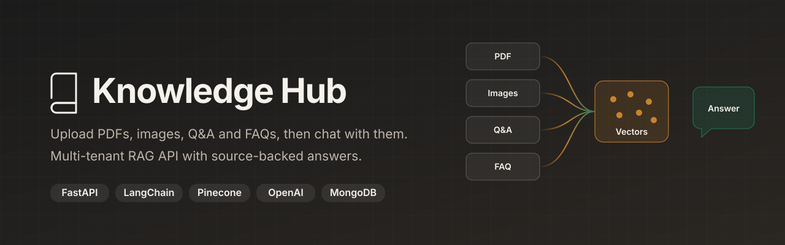
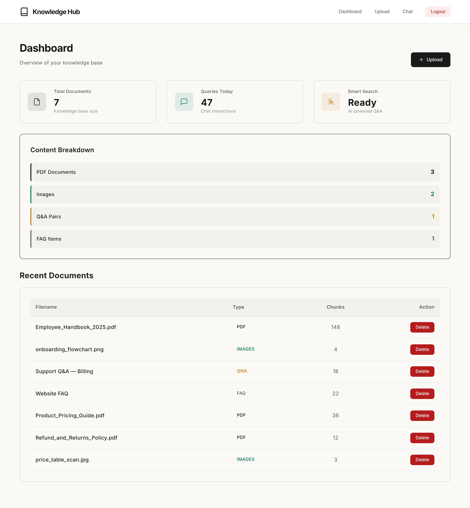
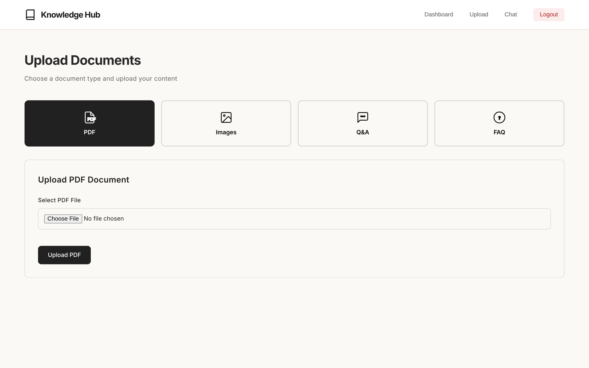
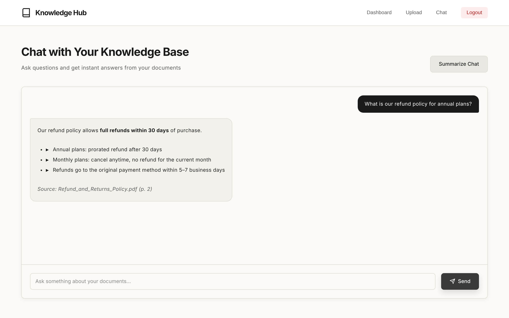
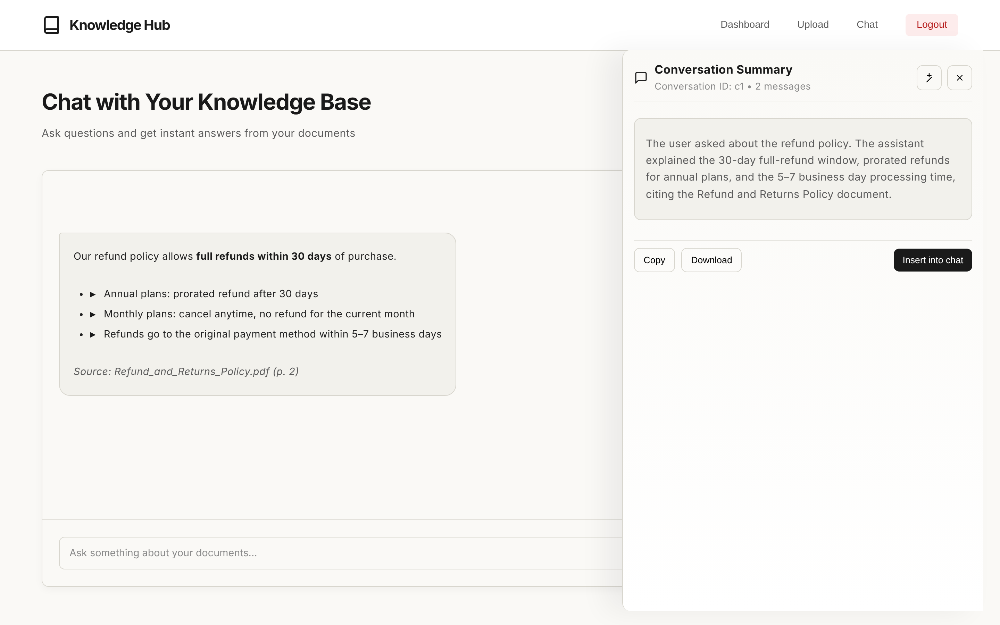
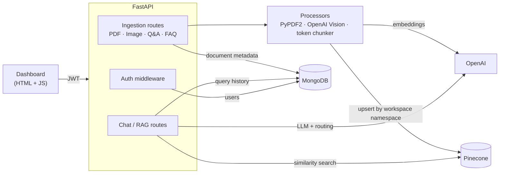
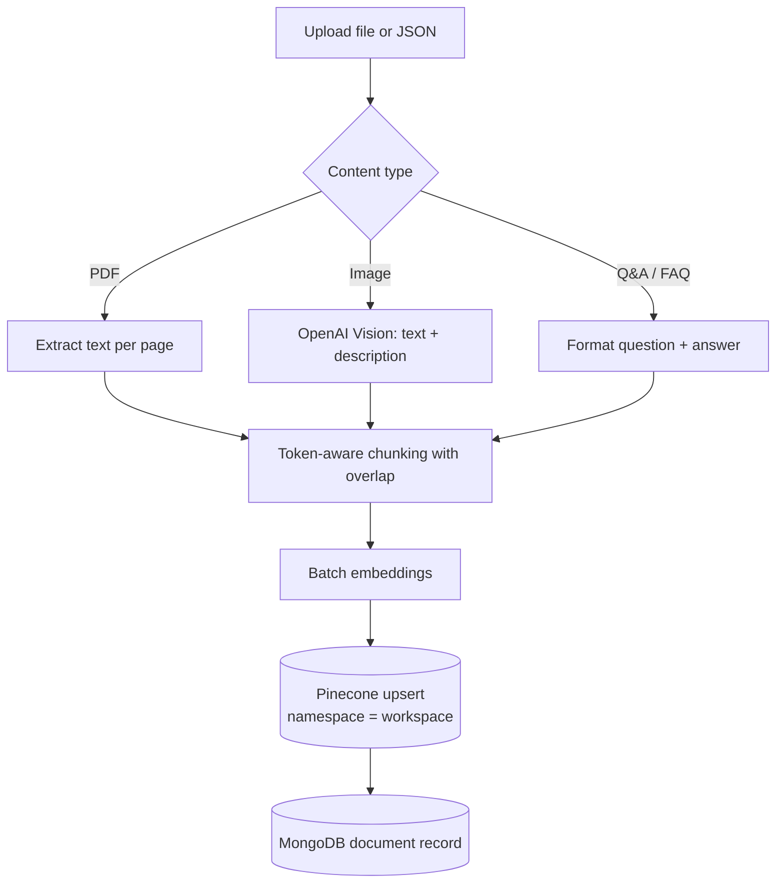
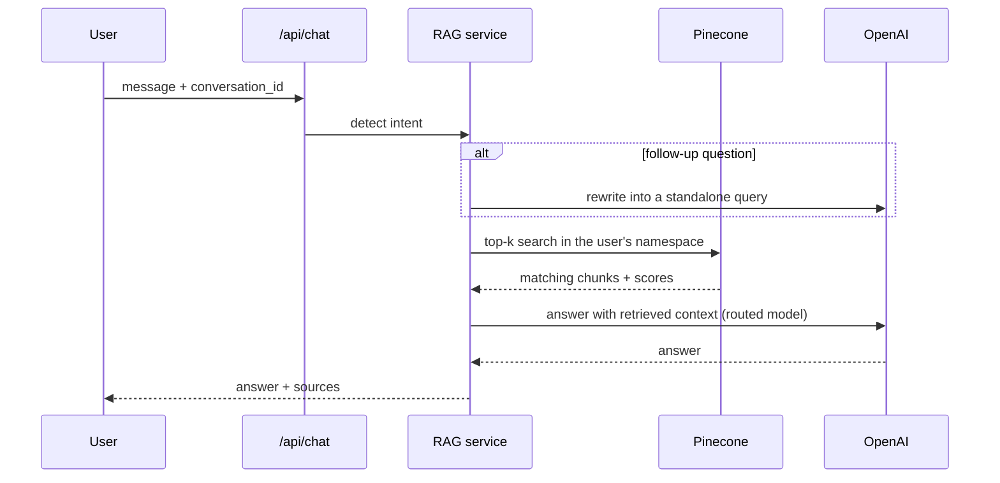

<p align="center">
  
</p>

<p align="center">
  
  
  
  
  
  
  
</p>

# Knowledge Hub: a multi-tenant LangChain + Pinecone knowledge assistant

Knowledge Hub turns a company's own content into a chat assistant. Users upload **PDFs, images, Q&A pairs and FAQs**. The API extracts and chunks the text, embeds it into **Pinecone**, and answers questions with a conversational **RAG** pipeline built on **LangChain** and **OpenAI**. Every account gets its own isolated workspace. A single-page dashboard is included for uploading content and chatting with it.

---

## 📸 Screenshots

| Dashboard | Upload |
|---|---|
|  |  |

| Chat | Conversation summary |
|---|---|
|  |  |

<sub>Screenshots use fictional demo data.</sub>

---

## ✨ Features

| | |
|---|---|
| 📄 **PDF ingestion** | Extracts text page by page (PyPDF2), then splits it with a token-aware chunker that keeps overlap between chunks |
| 🖼️ **Image understanding** | Uses OpenAI Vision to read text in screenshots, scans and diagrams and to describe them, so images become searchable too |
| 💬 **Q&A and FAQ ingestion** | Structured question/answer pairs are stored as their own chunks; long answers are split into labelled parts |
| 🧠 **Conversational RAG** | Detects intent (greeting, follow-up, question) and rewrites follow-ups into standalone queries using chat history before retrieving |
| ⚡ **Streaming responses** | Server-sent events endpoint for token-by-token answers |
| 🔀 **Smart model routing** | Short, simple questions go to a cheaper model and complex ones to a stronger model (configurable) |
| 📝 **Conversation summaries** | One-click summary of any conversation |
| 🔎 **Source-backed answers** | Responses include the retrieved chunks with similarity scores and document metadata |
| 🏢 **Multi-tenant workspaces** | Each account gets its own workspace ID, used as its Pinecone namespace and storage folder, so data never mixes |
| 🔐 **JWT authentication** | bcrypt-hashed passwords, 7-day tokens, and middleware that protects every non-auth route |

---

## 🏗️ Architecture



### Ingestion flow



### Chat flow



---

## 🧰 Tech stack

| Layer | Tools |
|---|---|
| API | FastAPI, Uvicorn, Pydantic v2, pydantic-settings |
| AI / RAG | LangChain, langchain-openai, langchain-pinecone, OpenAI (chat, embeddings, vision), tiktoken |
| Vector DB | Pinecone serverless (index auto-created on AWS) |
| Database | MongoDB (PyMongo) for users, documents and query history |
| Auth | JWT (python-jose), bcrypt |
| Front end | Single HTML/CSS/JS dashboard, marked.js for Markdown answers |

---

## 📁 Project structure

```
├── main.py                  # App setup, routers, CORS, JWT security scheme for Swagger
├── app/
│   ├── config.py            # Typed settings loaded from .env
│   ├── db.py                # MongoDB access (users, documents, history)
│   ├── middleware/auth.py   # JWT verification middleware
│   ├── models/              # Request/response schemas per content type
│   ├── routes/              # auth, pdf/image/qna/faq ingestion, rag, chat
│   └── utils/               # processors, chunking, OpenAI + Pinecone services, RAG engines
├── frontend/
│   └── knowledge_hub.html   # Dashboard · Upload · Chat
├── docs/                    # Banner and screenshots for this README
└── tests/
```

---

## 🚀 Getting started

### Prerequisites
- Python 3.11+
- MongoDB (local or Atlas)
- An OpenAI API key and a Pinecone API key

### 1. Install

```bash
python -m venv .venv
source .venv/bin/activate          # Windows: .venv\Scripts\activate
pip install -r requirements.txt
pip install pillow                 # used by the image processor
```

### 2. Configure

```bash
cp .env.example .env
```

Fill in `OPENAI_API_KEY`, `PINECONE_API_KEY`, `MONGODB_URI` and `SECRET_KEY`. `PINECONE_DIMENSION` must match the embedding model's output size. The service passes it to the embedding call and uses it when it creates the index.

### 3. Run

```bash
uvicorn main:app --reload --port 8000
```

- Swagger UI: http://127.0.0.1:8000/docs. Register, then click **Authorize** and paste the token.
- Dashboard: open `frontend/knowledge_hub.html` in a browser. It talks to `http://127.0.0.1:8000`.

---

## 🔌 API overview

| Area | Method & path | Purpose |
|---|---|---|
| Auth | `POST /api/auth/register` · `POST /api/auth/login` · `GET /api/auth/me` | Create account / get JWT / current user |
| PDF | `POST /api/knowledge-hub/ingest/pdf` · `GET …/pdf/list` · `DELETE …/pdf/{id}` | Upload, list, delete PDFs |
| Images | `POST /api/knowledge-hub/ingest/images` · `GET …/images/list` · `DELETE …/images/{id}` | Upload, list, delete images |
| Q&A | `POST /api/knowledge-hub/ingest/qna` · `GET …/qna/list` · `DELETE …/qna/{id}` | Manage Q&A pairs |
| FAQ | `POST /api/knowledge-hub/ingest/faq` · `GET …/faq/list` · `DELETE …/faq/{id}` | Manage FAQs |
| Chat | `POST /api/chat/message` · `POST /api/chat/stream` · `POST /api/chat/quick-answer` | Conversational answers (standard / streaming / one-shot) |
| Chat | `GET /api/chat/conversation/{id}` · `GET /api/chat/summary/{id}` · `DELETE /api/chat/conversation/{id}` | History, summary, reset |
| RAG | `POST /api/rag/query` · `GET /api/rag/history` · `GET /api/rag/workspace/stats` · `GET /api/rag/documents` | Direct retrieval queries and workspace stats |

Example:

```bash
TOKEN=$(curl -s -X POST localhost:8000/api/auth/login \
  -H "Content-Type: application/json" \
  -d '{"email":"demo@example.com","password":"secret"}' | jq -r .access_token)

curl -X POST localhost:8000/api/knowledge-hub/ingest/pdf \
  -H "Authorization: Bearer $TOKEN" -F "file=@handbook.pdf"

curl -X POST localhost:8000/api/chat/message \
  -H "Authorization: Bearer $TOKEN" -H "Content-Type: application/json" \
  -d '{"message":"What is the refund policy?"}'
```

---

## 🧪 Tests

```bash
python tests/test_file_handler.py
python tests/test_langchain_services.py   # needs OpenAI + Pinecone credentials
```
